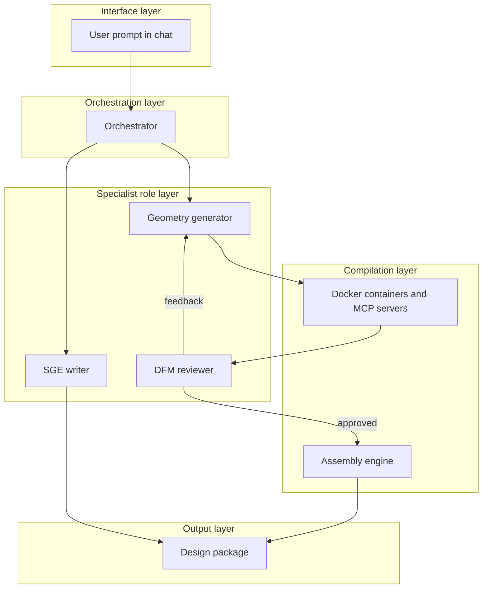

# NL Manufacturing Platform Hackathon MVP Plan

Project overview

This platform uses natural language to generate design prototypes for manufacturing. A user describes a part or an assembly. The system then generates the parametric files, 3D models, and technical documents.

The MVP scope is design prototype and proof of concept. The system does not do physical manufacturing. It makes design packages that a production team can use.

The platform supports these manufacturing methods:

- 3D printing (FDM and SLA)
- Laser cutting
- Sheet metal (designed in AutoCAD or a similar CAD tool, no physical fabrication in the MVP)
- PCB design (stretch goal)

Each design package includes:

- Parametric source files (OpenSCAD, SVG, DXF)
- 3D preview of the full assembly
- Bill of materials with cost report
- Assembly guide that follows SGE
- Specification sheet

All generated text follows [Standard Generated English (SGE)](https://github.com/WeirdCatAFK/SGE). SGE is an approximation of ASD-STE100 for text and code comments that AI agents write. It keeps each sentence short, literal and plain, so that a reader can read it in one way only.

## System architecture

The user sends a natural language prompt. The orchestrator routes the task to specialist roles. Each role uses the same LLM model with a different system prompt. The code generator writes parametric files. The DFM reviewer checks those files for manufacturing problems. If the reviewer finds a problem, it sends feedback to the generator.

The SGE compliance layer rewrites all text to SGE. Docker containers compile all code into output files. The assembly engine combines parts into a 3D preview. All outputs go into the design package.

## File generation backends

Each manufacturing method has a text-based parametric engine. The LLM writes code that compiles into geometry. Each engine runs in its own Docker container.

### 3D printing: OpenSCAD

OpenSCAD is a script-based CAD tool for parametric 3D models. Its syntax is simple and constrained. This makes it a good target for LLM code generation. The container takes an OpenSCAD script as input. It compiles the script and gives back an STL file and a preview render.

OpenSCAD supports variables, modules, and boolean operations (union, difference, intersection). The LLM can set dimensions as variables. This lets the user change parameters after the initial generation.

### Laser cutting: SVG and DXF

The system generates SVG files for laser-cut parts. SVG is a text-based vector format. LLMs can generate valid SVG with high accuracy. For tools that need DXF files, the system uses the Python library ezdxf to convert SVG to DXF.

The generator applies kerf compensation to all cut paths. It also checks minimum feature size against the laser specification.

### Sheet metal: CAD tool through MCP

The MVP does not fabricate sheet metal parts. The system designs them in AutoCAD or a similar CAD tool, through an MCP server. Each sheet metal part has a 3D model for the viewport and a DXF flat pattern for a fabricator.

The flat pattern puts the bend lines on a layer that is separate from the cut paths. A laser cutter can treat a bend line as a cut path ([FreeCAD SheetMetal wiki](https://wiki.freecad.org/SheetMetal_Workbench)). The team selects the CAD tool in phase 1.

### PCB design: KiCad (stretch goal)

KiCad uses text-based file formats for schematics and board layouts. Its Python API (pcbnew) can generate simple PCBs from component lists and connectivity data. Add this feature only if the team has KiCad experience.

The system takes a list of electronic components and their connections. It generates a schematic file and a board layout file.

## LLM orchestration layer

The system uses the Model Context Protocol (MCP) to connect the LLM to manufacturing tools. Each tool (OpenSCAD compiler, SVG generator, assembly viewer) is an MCP server. The LLM calls these servers to generate, compile, and review design files.

### Model roles

The hackathon provides a specific LLM. The system uses this one model with different system prompts for different roles. Each role has a separate prompt context. The model that generates a design does not review its own output.

| Role                           | Task                                                    | System prompt focus                                       |
| ------------------------------ | ------------------------------------------------------- | --------------------------------------------------------- |
| Orchestrator                   | Routes the conversation and calls specialist roles      | General reasoning and tool use                            |
| Geometry generator             | Writes OpenSCAD and SVG code                            | Structured code, constraint adherence                     |
| DFM reviewer                   | Checks designs against manufacturing rules              | Overhang angles, wall thickness, kerf                     |
| Assembly planner               | Sets the assembly order and fastener needs              | Sequential reasoning, constraints                         |
| SGE writer                     | Writes and rewrites all text to SGE                     | Controlled language rules                                 |
| Cost estimator                 | Calculates material volumes and part costs              | Numerical reasoning, structured output                    |
| Industrial engineer (optional) | Breaks down a production plan for manufacturing         | Process steps, tooling, production sequence, batch sizing |
| Design author (optional)       | Applies aesthetic finish and form to functional designs | Visual style, ergonomics, surface finish, form language   |

### Function and form as separate constraints

The user prompt must separate functional requirements from form requirements. The orchestrator separates the two sets in the first prompt, before it calls any core role. All core roles (geometry generator, DFM reviewer, assembly planner) work on function first. They treat form as a secondary constraint that must not break function. The design author then addresses form as its primary task.

Example prompt structure:

- **Function:** "The casing must hold a MicroATX board, support two 3.5-inch drives, and fit a standard 19-inch rack. It needs passive ventilation through side vents."
- **Form:** "Give the casing a futuristic look with angular lines, chamfered edges, and a dark matte finish. Add a subtle LED channel along the front edge."

The system tracks function and form as separate requirement categories in the project manifest from the start. The specification sheet lists which features serve function and which serve form. This separation makes it clear which constraints the design author can modify and which it must not change.

### Optional roles: industrial engineer and design author

These two roles are not required for the MVP. Add them when the team has time or when the demo benefits from them.

**Industrial engineer.** After the assembly planner sets the assembly order, the industrial engineer writes a production plan. This plan describes the manufacturing process step by step: which operations to do first, what tooling each step needs, how to batch parts for efficiency, and what quality checks to run between steps. The output is a production plan document that a manufacturing floor can follow.

**Design author.** After all functional roles approve the design, the design author applies a form language to the finished product. The user states a style direction in the original prompt as a separate constraint from function. Example directions: futuristic, industrial, ergonomic, minimal, organic.

The design author modifies surface geometry, edge treatments, fillets, chamfers, textures, and colour schemes. It does not change dimensions or features that affect function. It acts as the final revisor before the design package is complete.

### Supervision chain

The model that generates a file is not the same prompt context that reviews it. The DFM reviewer gets only the output geometry. Its prompt tells it to find manufacturing problems. This separation gives reliability.

A generation model can produce a wall that is 0.5 mm thick. That wall cannot be 3D printed. The DFM reviewer catches this error. It sends the design back with a correction.

### Workflow for each part

1. The user gives a natural language description of the part.
2. The orchestrator sends the description to the geometry generator.
3. The generator writes parametric code (OpenSCAD or SVG).
4. The container compiles the code into a mesh or vector file.
5. The DFM reviewer checks the output for manufacturing problems.
6. If the reviewer finds a problem, the generator gets feedback and makes a new version.
7. If the reviewer approves the design, the part goes into the assembly manifest.

## SGE compliance

All text that the system generates must follow [SGE](https://github.com/WeirdCatAFK/SGE). SGE replaces the ASD-STE100 approved word list with a list of words to avoid. It keeps the ASD-STE100 rules for sentence length, voice, and structure. It also limits code comments.

### SGE rules for this system

- Use a maximum of 20 words in each procedural sentence (instructions).
- Use a maximum of 25 words in each descriptive sentence.
- Use only active voice and simple verb tenses.
- Write only one instruction in each sentence.
- Do not use "-ing" forms as instructions (write "Tighten the bolt," not "Tightening the bolt").
- Do not use semicolons, phrasal verbs, em dashes, separator lines, arrows, emoji, or bold body text.
- Use the plain word. The SGE avoided-word list gives a replacement for each word to avoid.
- In code, write one optional file header of 3 lines or less, and doc comments of 5 lines or less directly above the code. Write no other comments.

### Project glossary

The SGE checker has no list of approved words. It does not flag a word only because the word is unknown. The project glossary lists the technical terms that the checker must not flag as words to avoid.

Examples of project technical terms: bolt, stepper motor, standoff, solder pad, kerf, infill, nozzle diameter, layer height, PCB, header pin.

Add new technical terms to the glossary when the user introduces them. Store the glossary as `sge-glossary.json` in the project directory.

### Enforcement pipeline

The system uses three stages to enforce SGE compliance:

1. SGE rewriter. A dedicated LLM prompt context rewrites all draft text into SGE form. This prompt contains the full SGE ruleset.
2. SGE checker. The rules-based checker `sge_check.py` (not an LLM) flags each finding. It needs only Python 3.8 or later.
3. Feedback loop. Text that fails the check goes back to the SGE rewriter. The rewriter corrects the flagged problems.

This pipeline applies to all text outputs: assembly guides, specification sheets, BOM notes, warnings, step descriptions, and code comments. The checker reads Markdown, Python, and JavaScript files. The system must add a reader for the comments in OpenSCAD files.

## Assembly composition engine

The assembly engine combines individual parts into a full product preview. It uses a project manifest to track all parts and their positions.

### Project manifest

The manifest is a JSON file. It contains an entry for each part in the assembly. Each entry has these fields:

- Part identifier and name
- Manufacturing method (3D print, laser cut, PCB)
- Source file path (OpenSCAD, SVG, or KiCad file)
- Compiled output path (STL or DXF file)
- Material and material properties
- Position in the assembly (X, Y, Z coordinates)
- Rotation in the assembly (X, Y, Z angles)
- Fastener requirements (bolt type, quantity)

The LLM generates this manifest. It sets positions and rotations on the basis of part dimensions and connection points.

### 3D assembly viewer

The frontend uses Three.js to show the full assembly. It loads STL and glTF meshes. It positions each mesh on the basis of the manifest coordinates.

The viewer lets the user do these operations:

- Rotate and zoom the full assembly
- Click a part to see its name, material, and dimensions
- Show or hide individual parts
- Show the assembly step by step (one part at a time)

For the MVP, use visual plausibility as the acceptance criterion. Do not try to do collision detection or interference analysis. The DFM reviewer checks for obvious fit problems on the basis of dimensions.

### Assembly order

The assembly planner role sets the order in which parts go together. It identifies which parts must be in position before other parts. It lists the fasteners and tools for each step.

## Standard parts library

The standard parts library is a local database of common hardware components. The system uses it at three stages: during clarifying questions (to give accurate recommendations), during geometry generation (to set correct dimensions), and during cost estimation. In cost estimation, it gives a reference price when the price lookup fails.

### Library structure

The library is a set of JSON files grouped by category. Each entry has these fields:

- Part identifier (e.g., M3x12-socket-head)
- Category (fastener, bearing, connector, motor mount, board, fan, standoff)
- Exact dimensions with tolerances (e.g., M3 bolt shaft diameter: 3.00 mm +/- 0.02 mm)
- Mounting geometry (hole diameter, hole spacing, standoff height)
- Material and material properties
- Supplier name and part number (e.g., McMaster-Carr 91292A117)
- Reference unit price and minimum order quantity
- Parametric OpenSCAD module that generates the part geometry

### Categories for the MVP

Build these categories first. They cover the most common parts in the demo scenarios.

| Category         | Example parts                                        | Source for dimensions                     |
| ---------------- | ---------------------------------------------------- | ----------------------------------------- |
| Metric fasteners | M2, M2.5, M3, M4, M5 bolts, nuts, washers, standoffs | ISO 4762, ISO 4032                        |
| Board mounts     | ATX, MicroATX, Mini-ITX, Raspberry Pi mounting holes | ATX specification, Pi mechanical drawings |
| Fans             | 40 mm, 60 mm, 80 mm, 120 mm standard fans            | Manufacturer datasheets                   |
| Drive bays       | 2.5-inch, 3.5-inch HDD and SSD mounting holes        | SFF-8301 specification                    |
| Connectors       | USB-C, barrel jack, JST, header pins                 | Connector datasheets                      |
| Rack hardware    | 19-inch rack rails, cage nuts, rack screws           | EIA-310 specification                     |

### How the system uses the library

When the LLM generates an OpenSCAD script that includes an M3 bolt hole, it must use the library dimension (3.2 mm clearance hole, not a guessed value). The geometry generator imports the parametric module from the library instead of writing the geometry from scratch.

When the user accepts a recommendation during the clarifying questions phase, the system pulls the part data from the library. It adds the part to the project manifest with the correct dimensions and price.

When the cost estimator calculates the BOM, it gets prices from the price lookup service. If the service finds no price, the estimator marks the price as "to be confirmed" in the cost report.

## Price lookup

Prices change often, so the library price is only a reference. The price lookup service gets a current price through a web search. It runs as an MCP server, and the orchestrator and the cost estimator call it.

Each price shows the supplier, the source URL, and the retrieval date. The service caches each price in the project directory. The cache also supplies the prices for the live demo when the network is not available.

When the search fails, the service uses the cached price or the library reference price. It marks the price as "cached" or "reference" with its date. For electronic components, the service can use a distributor API when the team has a key. Nexar gives access to the Octopart database ([Octopart API docs](https://octopart.com/api/docs)).

## Constraint check engine

The constraint check engine is a rules-based validator that runs after every geometry generation cycle. It checks the generated files against manufacturing rules and standard part dimensions. It runs before the DFM reviewer (which is an LLM role). The engine is deterministic code, not an LLM.

### Why both the engine and the DFM reviewer exist

The constraint check engine catches errors that are fast and cheap to detect with code: wrong hole diameters, walls below minimum thickness, features outside the build volume. The DFM reviewer (an LLM role) catches errors that need judgment: whether a part is practical to print in its current orientation, whether an assembly sequence is feasible, whether a design will be difficult to manufacture at scale. The engine handles the rules. The reviewer handles the reasoning.

### Constraint categories

**Dimensional constraints:**

- Every bolt hole diameter must match the standard parts library value for the specified bolt size (e.g., M3 clearance hole = 3.2 mm, not 3.0 mm).
- Every standoff position must match the board specification (e.g., ATX mounting holes at the positions that the ATX standard defines).
- Every mating surface must have matching dimensions within the stated tolerance.

**3D printing constraints:**

- Minimum wall thickness: 1.2 mm for FDM, 0.8 mm for SLA.
- Maximum overhang angle: 45 degrees without support for FDM.
- Minimum hole diameter: 2.0 mm for FDM.
- Maximum part dimensions must fit within the stated build volume.
- Bridge length must not exceed 10 mm without support.

**Laser cutting constraints:**

- Minimum feature size: 1.0 mm for acrylic, 0.5 mm for plywood.
- Kerf compensation applied to all cut paths (typical: 0.1 mm to 0.2 mm per side).
- Minimum distance between cuts: 2.0 mm.
- Part dimensions must fit within the stated bed size.

**Assembly constraints:**

- Every part in the manifest must have at least one connection to another part.
- Fastener holes must align between mating parts (position match within tolerance).
- No two solid parts may occupy the same space in the assembly (basic bounding-box overlap check).

### Engine output

The engine produces a validation report for each generation cycle. The report lists:

- Total number of checks that passed.
- Each failed check with the rule name, the measured value, the expected value, and the file and line number in the source code.
- A severity level for each failure: "error" (must fix before the design can proceed) or "warning" (the DFM reviewer should evaluate).

The geometry generator receives the error-level failures as feedback. It must fix these before the design goes to the DFM reviewer. The DFM reviewer receives the warnings and decides whether they are acceptable.

## Documentation generation

The system generates four document types for each design package. All documents follow SGE.

### Bill of materials (BOM)

The BOM parser reads the project manifest. It lists all parts with these data:

- Part name and quantity
- Material type and material properties
- Dimensions (from the STL or SVG file)
- Manufacturing method
- Unit cost (calculated, or from the price lookup service)

### Cost report

The cost estimator calculates approximate costs for each manufacturing method:

- 3D printing: material volume (from the STL mesh) multiplied by cost per unit volume. Add time cost on the basis of estimated print duration.
- Laser cutting: cut length (from the SVG path) multiplied by cost per unit length. Add material area cost.
- Electronic components: unit cost from the price lookup service.
- Fasteners and hardware: unit cost from the price lookup service, or the library reference price.

The report shows the total cost of the design package. It lists the cost per part and the cost per manufacturing method.

### Assembly guide

The assembly guide shows step-by-step instructions. Each step has:

- A rendered 3D view of the assembly at that step (a screenshot from the Three.js viewer)
- A list of parts to install in that step
- The fasteners and tools that the step needs
- Clear instructions in SGE

### Specification sheet

The specification sheet lists the properties of the full assembly:

- Overall dimensions and weight estimate
- Materials used
- Tolerance and accuracy data (from the parametric model)
- Manufacturing requirements

The system outputs all documents as PDF files. It uses a Markdown-to-PDF pipeline (weasyprint or Puppeteer).

## Frontend

The frontend is a Next.js web application. It has four main views.

### Chat interface

This is the primary input method. The user types natural language descriptions of parts and assemblies. The system shows status updates as it generates files. The user can ask for changes to generated designs.

During the clarifying questions phase, each question shows as a card with the question text, a quality recommendation, a cost recommendation, and three action buttons: "Use quality pick," "Use cost pick," and a text input for a custom answer. The user can also skip the question. A progress bar shows how many questions remain.

### 3D viewport

The viewport uses Three.js to render the assembly. It shows all approved parts in their manifest positions. The user can rotate, zoom, and click parts to see details. A step-by-step mode shows the assembly order.

### File browser

The file browser shows all generated artifacts in the project:

- Source files (OpenSCAD scripts, SVG files)
- Compiled outputs (STL meshes, DXF files)
- Documents (BOM, cost report, assembly guide, specification sheet)
- The project manifest (JSON)

The user can download any file. The user can also open source files to see the parametric code.

### Revision panel

The revision panel shows the LLM commentary on the current design. It lists the results from the DFM reviewer and the SGE checker. The user can accept or reject each suggestion. The user can also ask for a full redesign of a specific part.

## Demo scenario

Before the system generates any file, it must ask the user between 15 and 50 clarifying questions. These questions make sure that the scope is clear and that the design is possible to manufacture. This requirements-gathering phase is a core feature, not an optional step.

### Clarifying questions phase

The orchestrator generates questions about these categories:

- **Dimensions and tolerances** -- What are the exact measurements? What tolerance does each connection need? What is the maximum size that the manufacturing method permits?
- **Material selection** -- What material does each part need? What are the temperature, weight, and strength requirements? What is the budget for materials?
- **Manufacturing constraints** -- What 3D printer does the user have access to? What is the maximum build volume? What laser cutter bed size is available? Does the user have access to PCB fabrication?
- **Assembly and fasteners** -- How will parts connect? What fasteners are available? Does the assembly need to be taken apart for maintenance or cleaning?
- **Environment and use** -- Where will the product operate? What temperatures, humidity, and physical stress will it face? Does it need water or dust resistance?
- **Electrical requirements** -- What power source is available? What voltage and current does each component need? Does the device need a battery? How long must the battery last?
- **Scope boundaries** -- What is in scope for this design? What is out of scope? What is a stretch goal? How many units does the user plan to build?

### Recommendations with each question

When the system asks a question about a component or material, it also gives recommendations. Each recommendation has two options:

- **Quality pick** -- The component that gives the best performance, reliability, or feature set for this design. The system states why this option is the better choice.
- **Cost pick** -- The component that meets the minimum requirements at the lowest price. The system states what trade-offs this option makes.

The system searches the standard parts library for the components and the price lookup service for current prices. Each recommendation shows the component name, the price, and a one-sentence reason for the pick.

Example for the Raspberry Pi cluster scenario:

| Question                 | Quality pick                                                      | Cost pick                                                                |
| ------------------------ | ----------------------------------------------------------------- | ------------------------------------------------------------------------ |
| What Raspberry Pi model? | Pi 5 8 GB -- fastest CPU, best thermal headroom for clusters      | Pi 4 4 GB -- sufficient for most workloads at 40% lower cost             |
| What fan size?           | Noctua NF-A6x25 (60 mm) -- quiet, high static pressure, long life | Generic 40 mm brushless -- fits smaller enclosure, costs less than 2 USD |
| What power connector?    | USB-C PD -- standard, supports negotiated voltage                 | Barrel jack 5 V -- simple, no negotiation circuit needed                 |

The user can accept a recommendation with one click (the "Use this" button), type a custom answer, or skip the question to use the default value. The system logs every accepted recommendation and every custom answer in the project manifest.

When the user does not know the answer to a technical question, the recommendation gives them a starting point. This reduces the number of questions that feel difficult to answer. It also keeps the design within known manufacturing constraints, because the system recommends only components that it can generate files for.

The system does not generate files until it has enough answers to make a design that can be manufactured. Questions that the user does not answer get default values. The system states all defaults in the specification sheet.

### Demo scenario A: custom MicroATX server rack casing

Prompt: "Generate a custom casing that takes MicroATX motherboards and transforms office computers into rack-mountable units for an on-demand computer rental service. The computers turn on only when a customer rents time. The design must fit a standard 19-inch server rack."

Sample clarifying questions (15 to 50 total):

1. What is the exact MicroATX board model (or range of models) that the casing must hold?
2. How many drive bays does each unit need? What drive sizes (2.5-inch, 3.5-inch)?
3. Does the casing need a front panel with power and status indicators?
4. What cooling method does each unit need (passive vents, single fan, dual fan)?
5. Must the vents be adjustable or movable?
6. What is the power supply form factor (ATX, SFX, external)?
7. Does the rack need cable management channels?
8. How many units must fit in one standard 42U rack?
9. Does each unit need a remote power-on circuit (Wake-on-LAN, relay, IPMI)?
10. What is the ambient temperature of the server room?
11. Must the casing allow hot-swap of drives without tools?
12. What material is acceptable for the casing (sheet metal, 3D-printed, laser-cut acrylic)?
13. What is the maximum cost per unit for the casing?
14. Does the design need a locking mechanism?
15. What are the rack rail dimensions and mounting-hole spacing?

Manufacturing challenges for the system:

- Sheet metal bends, tabs, and slots for a 19-inch rack-mountable casing
- Ventilation holes that do not weaken the structure
- Tolerances for MicroATX standoff positions (must match the ATX specification exactly)
- Cable routing cutouts that keep minimum bend radius
- Stackable alignment features that use no tools

### Demo scenario B: stackable Raspberry Pi cluster with power distribution

Prompt: "Generate a stackable enclosure for Raspberry Pi boards with a fan on top. The enclosures connect to a custom power distribution board with sockets for each Pi. Design for a cluster of 8 units."

Sample clarifying questions (15 to 50 total):

1. What Raspberry Pi model (Pi 4, Pi 5, Compute Module)?
2. What are the dimensions of each Pi board with its heat sink?
3. Does each enclosure hold one Pi or more than one?
4. What fan size and airflow direction (40 mm, 60 mm, intake, exhaust)?
5. How do the enclosures stack (clips, rails, threaded rods, magnets)?
6. Does the power board take mains AC or a single DC input?
7. What current does each Pi draw at peak load?
8. Does each socket need an individual power switch or fuse?
9. Does the design need Ethernet routing channels between enclosures?
10. What GPIO ports must remain accessible when the Pi is in the enclosure?
11. Must the SD card slot remain accessible without disassembly?
12. What is the total height limit for the stacked cluster?
13. Does the enclosure need mounting holes for wall or shelf attachment?
14. What is the operating temperature range?
15. Does the power board need status LEDs for each channel?
16. What connector type for the power output to each Pi (USB-C, barrel jack, custom header)?

Manufacturing challenges for the system:

- Precise alignment features for repeatable stacking
- Fan mount that does not transmit vibration to the stack
- Power distribution PCB with correct trace widths for the total current
- Snap-fit enclosure that permits disassembly without tools
- Thermal design that keeps each Pi under its throttle temperature

### Demo scenario C: rugged field data collector

Prompt: "Generate a carry-on device that stores sensor data in rough climates. It needs an environmental sensor and GPS module. The device sends location data so that explorers can recollect it later. It must operate on battery power for at least 72 hours."

Sample clarifying questions (15 to 50 total):

1. What environmental data must the sensor collect (temperature, humidity, pressure, UV, wind)?
2. What is the GPS accuracy requirement?
3. How does the device send location data (cellular, satellite, LoRa, stored only)?
4. What is the operating temperature range (arctic, desert, tropical, all)?
5. What IP rating does the enclosure need (IP54, IP67, IP68)?
6. What battery chemistry (lithium-ion, lithium iron phosphate)?
7. What is the maximum weight for the complete device?
8. How does the user access stored data (USB, Wi-Fi, physical SD card)?
9. How often does the device record a data point (every second, every minute, every hour)?
10. Does the device need a display or status indicators?
11. Must the device survive a drop from 1.5 meters onto concrete?
12. Does the enclosure need mounting points (belt clip, carabiner loop, magnetic mount)?
13. What is the production quantity (1 prototype, 10 units, 100 units)?
14. Does the battery need to be user-replaceable in the field?
15. Must the device work at altitudes above 3000 meters?
16. Does the device need a physical on/off switch or a magnetic reed switch?
17. What is the acceptable cost per unit for the enclosure and PCB?

Manufacturing challenges for the system:

- Waterproof enclosure with gasket channels and sealed cable entries
- PCB layout with antenna placement that does not block GPS or cellular signal
- Battery compartment with correct ventilation and thermal isolation
- Shock-absorbing internal mounts for the sensor and GPS modules
- Low-power circuit design that meets the 72-hour battery life requirement

### Key points to show in each demo

- The system asks between 15 and 50 clarifying questions before it generates any file. Each question targets a specific manufacturing or design constraint.
- Unanswered questions get explicit default values. The specification sheet lists all defaults.
- The generated files are parametric. The user can change any dimension or material after the first generation.
- The supervision chain (DFM reviewer) catches problems that the geometry generator missed.
- All documentation follows SGE without manual editing.
- The assembly preview shows how all parts fit together in three dimensions.
- The cost report gives a credible estimate for the stated production quantity.

## Known constraints and hard problems

### Dimensional accuracy

LLMs can produce incorrect dimensions. A model can set a hole diameter to 2 mm when the bolt needs 3 mm. Use these defenses:

- Keep a standard parts library with correct dimensions for common hardware (M3, M4, M5 bolts and nuts, NEMA stepper mounts, common bearing sizes).
- Run constraint checks against the parts library after each generation.
- Show dimensions in the 3D viewport so the user can verify them.

### Assembly fit

The system cannot guarantee that Part A connects correctly to Part B in all cases. The MVP uses visual plausibility and dimension comparison. It does not do full interference analysis.

For the hackathon, limit the demo to assemblies with simple connections (bolt through hole, flat surface on flat surface). Do not attempt complex joints or press fits.

### Manufacturing constraint coverage

The DFM reviewer checks a limited set of rules:

- 3D printing: minimum wall thickness, maximum overhang angle, minimum hole diameter
- Laser cutting: minimum feature size, kerf compensation, material thickness limits

The reviewer does not cover all possible manufacturing failures. State this limitation clearly in the presentation.

### SGE checker coverage

The SGE checker uses word lists, not a grammar parser. It can give some sentences the wrong kind (procedural or descriptive). It does not find noun clusters, omitted words, or false facts ([SGE rules](https://github.com/WeirdCatAFK/SGE)). The SGE rewriter prompt must cover these gaps.

The avoided-word list can flag a real manufacturing term. Add each such term to the project glossary. Review the glossary before each demo.

### Price accuracy

A price from a web search is an approximation. The page can be old, or the price can be for a different quantity. The cost report shows the source URL and the date of each price, so the user can check it.

## Technology stack

| Layer                | Technology                            | Purpose                                               |
| -------------------- | ------------------------------------- | ----------------------------------------------------- |
| Frontend             | Next.js, Three.js                     | Web application and 3D assembly viewer                |
| LLM orchestration    | MCP servers                           | Connection between LLM and manufacturing tools        |
| 3D printing engine   | OpenSCAD in Docker                    | Parametric 3D model generation and STL compilation    |
| Laser cutting engine | Python (SVG generation, ezdxf)        | Vector file generation and DXF conversion             |
| Sheet metal engine   | CAD tool through MCP (to be selected) | 3D sheet metal model and DXF flat pattern             |
| PCB engine (stretch) | KiCad Python API                      | Schematic and board layout generation                 |
| Assembly engine      | JSON manifest, Three.js               | Part composition and 3D preview                       |
| Price lookup         | Web search through MCP                | Current component prices with source and date         |
| SGE compliance       | LLM rewriter, `sge_check.py`        | SGE enforcement on all text and code comments         |
| Documentation        | Markdown to PDF (weasyprint)          | BOM, cost report, assembly guide, specification sheet |
| Infrastructure       | Docker Compose                        | Container orchestration for all services              |

All containers run with Docker Compose for local development. The architecture is ready for Kubernetes if the project moves to production.
